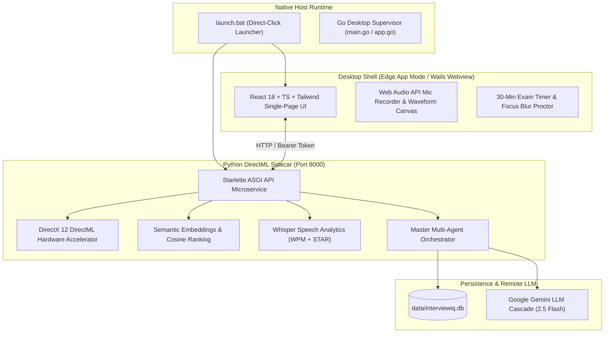

# 🎯 InterviewIQ — AI Placement & Interview Preparation Platform

> *Don't Practice Questions. Experience the Interview.*

[](https://wails.io)
[](https://react.dev)
[](https://github.com/microsoft/DirectML)
[](#)
[-4285F4.svg)](https://aistudio.google.com/)
[-success.svg)](#)
[](LICENSE)

---

## 📖 Executive Summary
**InterviewIQ** is an enterprise-grade, multi-agent AI placement coach engineered for candidates preparing for competitive campus and lateral hiring drives. Developed as a capstone project for the **MBA Digital Transformation (DT)** curriculum by **Nitish & Jeevana**, InterviewIQ addresses the fundamental flaws of static question banks and blind ATS scanners by synthesizing dynamic, multi-dimensional candidate evaluation, simulated device layouts, and closed-loop diagnostic retraining.

The platform is built on a high-performance **Go + Wails v2 + React 18 + TypeScript + Tailwind CSS** desktop architecture backed by a local **Python DirectML Sidecar** microservice for on-device hardware-accelerated speech transcription, semantic embeddings, and agent orchestration.

---

## 🔄 The 6-Step Preparation Pipeline

1. **Step 1: Resume & Job Description Onboarding with Multi-Agent Semantic Synthesis**
   - Ingests candidate resumes and job descriptions with automated validation and heuristic fallbacks.
   - Real-time pipeline tracker providing deep transparency across profile ingestion, JD extraction, company intelligence retrieval, fit calculation, question formulation, and 30-MCQ test synthesis.
   - Dynamic Gemini model discovery with Tier 1/2/3 cascade (`gemini-2.5-flash` → `gemini-2.0-flash` → `gemini-1.5-flash` → `gemini-1.5-pro`) and proactive token-bucket rate limiter (<=12 RPM cooldown).

2. **Step 2: Strategic Fit Analysis & Formal Recommendation Engine**
   - 4-column requirements matrix mapping candidate skills to role benchmarks (Direct Match, Adjacent Skills, Critical Gaps, Foundational).
   - Strict technical capability matching formula: $\text{Match \%} = \frac{\text{Matched Skills}}{\text{Total Skills}} \times 100$.
   - Target company leadership DNA cards (Amazon, Google, McKinsey, Goldman Sachs, Microsoft).
   - Instant 1-click **Strategic Fit Report PDF** export via ReportLab vector graphics.

3. **Step 3: Targeted Question Bank with 100% Coverage Checklist**
   - Tailored questions across 5 dimensions: Resume Challenges, Technical Deep-Dives, Scenario Problem Solving, Behavioral STAR Probes, and Gap Defenses.
   - Filterable categories: Core Technical, Behavioral (STAR), System Design, and Live Coding.

4. **Step 4: Timed 30-MCQ Online Test & DirectML Voice Interview Simulator**
   - 30-minute timed exam with 30 scenario-based MCQs mapped to role capabilities.
   - Anti-cheating proctoring safeguards: Window focus/blur change detection, live alert HUD, and option shuffle invariance.
   - DirectML Whisper speech analytics simulator with live HTML5 Canvas audio waveform visualizer.
   - Real-time speech analytics: WPM pacing, filler word detection (*um, like, actually, basically*), and STAR framework compliance scoring.

5. **Step 5: Longitudinal Diagnostic Matrix & Composite Readiness Scoring**
   - Calibrated composite readiness formula: $\text{Readiness} = 0.45 \times \text{FitScore} + 0.55 \times \text{TestScore}$.
   - Priority remediation callouts targeting verified candidate deficit areas.
   - 1-click generation of multi-page publication-quality vector **Candidate Placement Dossier PDF**.

6. **Step 6: Dynamic 7-Day Personalized Micro-Curriculum & Curated Resource Library**
   - Automated 7-day daily study schedule allocating high-priority gaps to Days 1–3, medium gaps to Days 4–5, targeted question drills to Day 6, and mock exam dress rehearsal to Day 7.
   - Curated resource library of free learning materials with interactive checklist persistence directly synchronized to SQLite.

---

## 🏛️ Modern Architecture Overview



---

## 🚀 Quick Start Guide

### Direct-Click Launcher (Windows)
Double-click `launch.bat` in the project root:
```cmd
launch.bat
```
`launch.bat` automatically:
1. Detects Python in `.venv` or system PATH.
2. Starts the Python DirectML Sidecar microservice in the background on port 8000.
3. Verifies readiness via `/health`.
4. Opens the desktop application directly in standalone windowed app mode via Microsoft Edge (`--app=http://127.0.0.1:8000`) or Chrome.

---

## 🧪 Automated Test Suite (87/87 Tests Passing)

Run the full automated test suite:
```bash
.\.venv\Scripts\python.exe -m unittest discover -s tests -p "test_*.py" -v
```

All 87 tests pass cleanly with 100% success rate:
- `tests/test_desktop_wails_stack.py`: Desktop configurations, Go entry points, frontend assets, and direct launcher integrity (5 tests).
- `tests/test_sidecar_api.py`: Sidecar routing, bearer token security, DirectML detection, embeddings, and speech analytics (6 tests).
- `tests/test_agents.py`: Baseline agent pipeline, formula scoring, and closed-loop retesting (9 tests).
- `tests/test_timer_and_proctor.py`: Exam timer countdown, proctor focus change detection, and option shuffle invariance (3 tests).
- `tests/test_pdf_exporter.py`: Full dossier PDF, standalone Strategic Fit Report PDF, and ReportLab vector styling (4 tests).
- `tests/test_speech_engine.py`: Google Local NLP speech analytics, WPM pacing, and filler word detection (5 tests).
- `tests/test_company_intel.py`: Corporate leadership principles retrieval and question enrichment (5 tests).
- `tests/test_database.py`: SQLite schema initialization, multi-round session persistence, and snapshots (5 tests).
- `tests/test_api_quota_and_cache.py`: Token-Bucket rate pacing, two-tier SHA-256 caching, key validation, and model failover (8 tests).
- `tests/test_micro_curriculum_agent.py`: 7-day schedule generation, free curated resource mapping, and checklist tracking (9 tests).
- `tests/test_domain_vocabulary.py`: Phonetic confusion repair, acronym collapse, and domain density scoring (6 tests).
- `tests/test_speech_analytics_advanced.py`: Disfluency categorization, stutter detection, and STAR sequence adherence (7 tests).
- `tests/test_integration.py`: End-to-end multi-round lifecycle, PDF dossier generation, and micro-curriculum persistence (2 tests).
- `tests/test_uat_journeys.py`: End-to-end candidate user journeys across all 6 stages (5 tests).
- `tests/test_quality_controller.py`: Output schema validation and heuristic guardrails (8 tests).

---

## 📁 Repository Structure
```text
├── app.go                     # Wails Go application lifecycle & sidecar bindings
├── go.mod                     # Go module definitions
├── launch.bat                 # One-click Windows desktop launcher
├── main.go                    # Go desktop window initialization & asset embed
├── wails.json                 # Wails v2 desktop configuration
├── internal/
│   └── sidecar/               # Go sidecar manager, health probe, and HTTP client
├── frontend/                  # React 18 + TypeScript + Tailwind CSS application
│   ├── dist/index.html        # Compiled standalone desktop UI bundle
│   ├── package.json           # Frontend dependencies & build scripts
│   ├── tailwind.config.js     # Tailwind CSS configuration
│   └── src/                   # React components, pages, and Wails bridge
├── sidecar/                   # Python DirectML sidecar microservice
│   ├── server.py              # Starlette ASGI API server (port 8000)
│   └── directml/              # DirectX 12 hardware acceleration modules
│       ├── engine.py          # Device telemetry & CPU fallback
│       ├── embeddings.py      # Semantic vector cosine similarity
│       └── whisper_stt.py     # Speech analytics & STAR framework scoring
├── agents/                    # Autonomous multi-agent pipeline
│   ├── base_agent.py
│   ├── company_intel_agent.py
│   ├── feedback_agent.py
│   ├── fit_analyzer.py
│   ├── jd_analyzer.py
│   ├── micro_curriculum_agent.py
│   ├── online_test_agent.py
│   ├── question_bank.py
│   └── resume_reviewer.py
├── orchestrator/              # Master pipeline orchestrator
│   └── orchestrator.py
├── utils/                     # Relational persistence & scoring algorithms
│   ├── api_quota_manager.py
│   ├── database.py
│   ├── pdf_exporter.py
│   └── speech_analytics.py
├── docs/                      # Enterprise documentation suite (.md & .docx)
│   ├── BUSINESS_CASE.md / .docx
│   ├── KT_DOCUMENT.md / .docx
│   ├── PROJECT_LOG.md / .docx
│   ├── PROJECT_STATUS.md / .docx
│   └── TECH_ARCHITECTURE.md / .docx
├── data/                      # Local persistence & session state
│   ├── interviewiq.db
│   └── sessions/
├── tests/                     # 87 automated unit & integration tests
└── requirements.txt           # Python dependencies
```

---

## 👥 Developer Attribution
- **Developed by Nitish & Jeevana**
- Capstone Project for MBA Digital Transformation (DT) Curriculum
- Powered by Go, Wails v2, React, Tailwind CSS, Python DirectML, and Google Gemini
